# PROYECTO SISTEMA DISTRIBUIDO

**Materia:** Sistemas Distribuidos  
**Actividad:** Tarea 995 — Construir el sistema distribuido  
**Estudiante:** Miguel Angel Borges Mendez  
**Fecha del corte de las pruebas:** 26 de octubre de 2026


## Contenido

- [Parte I. Desarrollo y construcción](#parte-i-desarrollo-y-construcción-del-sistema)
- [Parte II. Plan y ejecución de pruebas](#parte-ii-plan-y-ejecución-de-pruebas)
- [Parte III. Incidencias, resultados generales y conclusiones](#parte-iii-análisis-general-incidencias-y-conclusiones)

---

# Parte I. Desarrollo y construcción del sistema

## 1. Introducción

En este proyecto trabajé en la construcción de un sistema distribuido para consultar un catálogo de productos. La idea principal no era hacer solamente una página web que mostrara información, sino crear una aplicación formada por distintos servidores que se comunicaran entre sí. De esa manera, una petición del usuario no tenía que depender de que todos los procesos estuvieran ejecutándose dentro del mismo programa o de un solo contenedor.

Para desarrollarlo utilicé **Docker Desktop sobre Windows**, con **Git Bash** para ejecutar los comandos y **Docker Compose** para organizar todos los servicios. Elegí trabajar con Compose porque el proyecto necesitaba levantar servidores web, aplicaciones, bases de datos, balanceadores, sistemas de replicación y monitorización. Hacer esto manualmente, contenedor por contenedor, habría vuelto más difícil mantener las conexiones, las variables y el orden de inicio.

El proyecto quedó organizado en **tres capas: presentación, aplicación y datos**. También incorporé herramientas que permiten distribuir peticiones, mantener copias de la información y conocer el estado de los servicios. La configuración revisada contempla **30 servicios**, aunque algunos de ellos son tareas de inicialización que terminan una vez que realizan su trabajo, además de tres redes principales y siete volúmenes nombrados.

Uno de los aprendizajes más importantes fue que tener varios contenedores no significa automáticamente tener un sistema tolerante a fallas. Para conseguirlo también fue necesario configurar correctamente los balanceadores, las conexiones entre servicios, los mecanismos de elección del servidor principal y los chequeos de salud. Gran parte del tiempo de implementación se dedicó precisamente a corregir esos detalles.

## 2. Objetivo del trabajo

El objetivo general fue desarrollar una aplicación web distribuida que pudiera atender peticiones a través de varios servidores, almacenar su información en servicios especializados y contar con mecanismos para reducir el impacto de fallas individuales.

En particular, busqué separar las responsabilidades por capas, poner en funcionamiento tres servidores Nginx y tres aplicaciones Node.js, implementar HAProxy y Keepalived en las dos capas de acceso, configurar una base relacional replicada con MariaDB Galera, integrar MongoDB como conjunto de réplicas, agregar una caché Redis con Sentinel y, finalmente, supervisar los componentes mediante Nagios.

También consideré desde la construcción la posibilidad de revisar por dónde viajaba una solicitud. Si el sistema respondía correctamente, necesitaba saber **qué servidor web y qué aplicación habían participado**, ya que esa información sería importante tanto para depurar errores como para comprobar el balanceo en las pruebas posteriores.

## 3. Arquitectura general del sistema

El funcionamiento comienza cuando el usuario entra a la dirección local del proyecto. La petición es recibida por el balanceador de presentación, que la dirige a uno de tres servidores Nginx. Cuando la página necesita información del catálogo, la solicitud continúa hacia el balanceador de aplicaciones y llega a una de las tres API Node.js. Estas aplicaciones consultan los servicios de almacenamiento o la caché según lo que solicite el usuario.

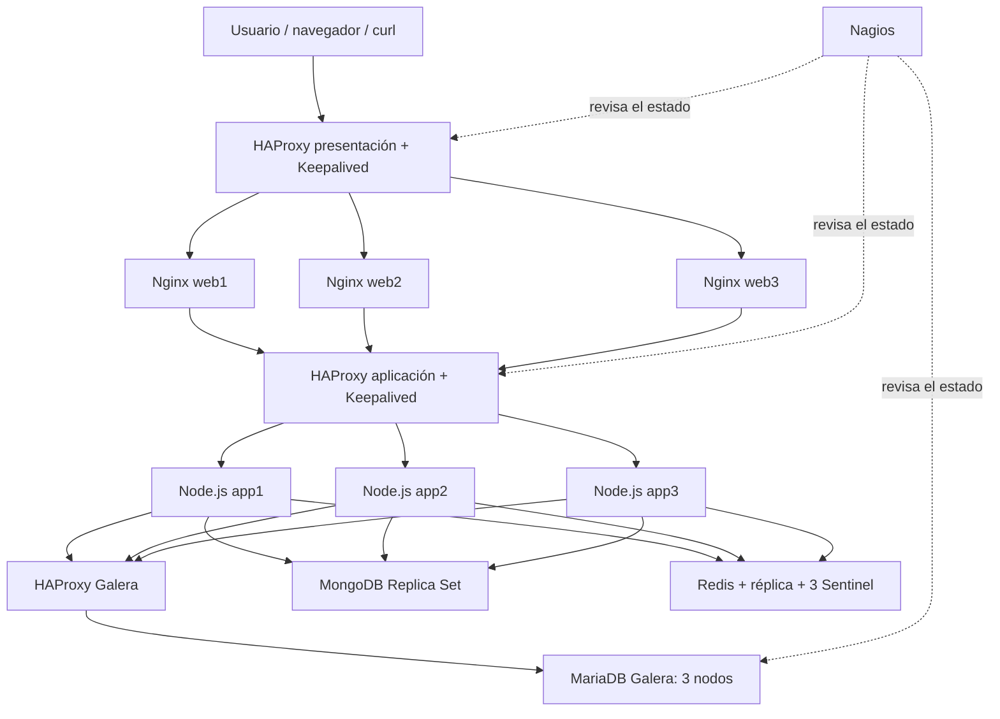

Para separar la comunicación definí tres redes Docker: `edge` con el rango `172.30.0.0/24`, `application` con `172.31.0.0/24` y `database` con `172.18.0.0/16`. Las dos últimas se manejan como redes internas en la configuración examinada. Esta separación ayuda a que los componentes no estén expuestos sin necesidad al mismo nivel de acceso y permite mantener una ruta más clara entre presentación, lógica y persistencia.

El balanceador de presentación utiliza una IP virtual interna, `172.30.0.250`, mientras que la capa de aplicación utiliza `172.31.0.250`. Las direcciones virtuales se administran con Keepalived y tienen como propósito que los componentes internos apunten a una dirección de servicio, en lugar de depender únicamente de la dirección particular de un balanceador.

## 4. Preparación del entorno y organización con Docker Compose

Antes de integrar toda la arquitectura, preparé la estructura de trabajo y revisé el archivo `docker-compose.yml`. En él se definieron los servicios, las imágenes, los puertos, las redes, los volúmenes, las variables de entorno y las relaciones de dependencia. El archivo Compose funcionó como el punto central del proyecto: cuando agregaba un componente nuevo, también tenía que comprobar qué otros servicios necesitaba para funcionar.

Otra parte importante fue manejar los valores de configuración mediante un archivo `.env`. Esto permitió separar nombres de usuarios, contraseñas y parámetros del entorno de los archivos principales. Para compartir el proyecto en GitHub no se deben publicar los valores reales de ese archivo; la alternativa correcta es una plantilla `.env.example` con nombres de variables y valores de ejemplo sin información privada.

Durante las primeras ejecuciones revisé los estados con `docker compose ps`, los mensajes de cada contenedor con `docker logs` y la conectividad mediante comandos ejecutados dentro de los contenedores. Estos pasos fueron necesarios porque un proceso podía aparecer encendido y aun así no estar listo para recibir conexiones, especialmente en las bases de datos replicadas.

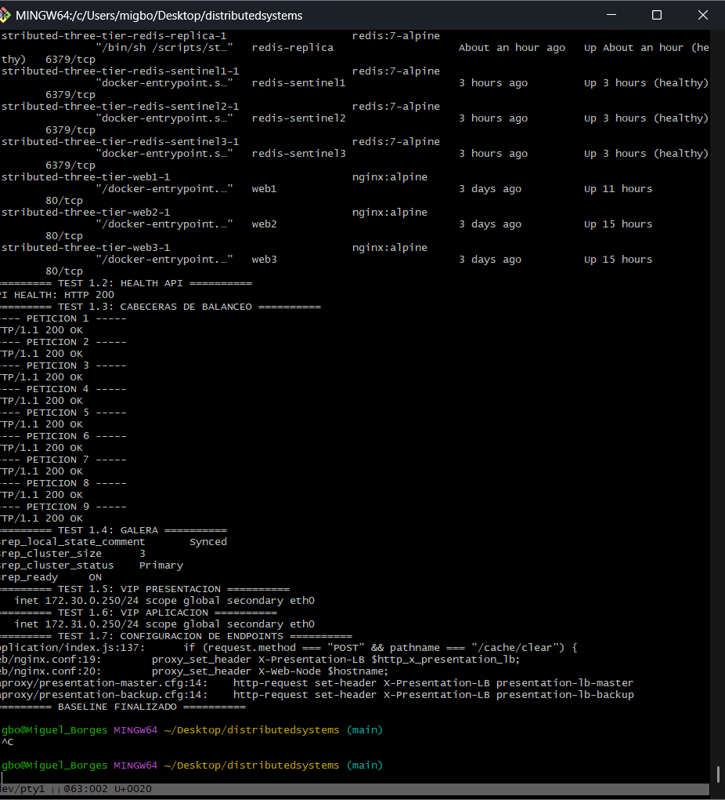

*Figura 1. Revisión del estado de los contenedores, respuesta HTTP de la API, estado Galera y direcciones virtuales utilizadas en el laboratorio.*

## 5. Construcción de la capa de presentación

### 5.1 Tres servidores Nginx

En la capa de presentación utilicé tres servicios Nginx: `web1`, `web2` y `web3`. Cada uno representa una instancia independiente capaz de responder solicitudes web. La ventaja de tener tres es que el balanceador puede repartir las peticiones, en vez de enviar todo el tráfico a un único servidor. La intención también era que, si una instancia deja de estar disponible, el balanceador pueda quitarla de su conjunto de servidores activos.

La configuración de Nginx se revisó mediante `nginx -t`. Esta validación resultó útil cuando modifiqué las cabeceras de respuesta, porque permite detectar problemas de sintaxis antes de aplicar los cambios. Después realicé una recarga de configuración en los tres servidores sin tener que reconstruir toda la aplicación.

### 5.2 HAProxy para distribuir solicitudes

Para repartir el tráfico entre los Nginx configuré HAProxy con el algoritmo `roundrobin`, registrando `web1`, `web2` y `web3` como servidores de destino. También incorporé chequeos de disponibilidad, para que la lista de backends no dependa solamente de que un contenedor exista, sino de que responda a las verificaciones correspondientes.

El balanceo era una parte fundamental del proyecto. Por ejemplo, si todas las solicitudes terminaban siempre en `web1`, entonces tener tres contenedores no aportaría la distribución esperada. Por eso, desde la configuración, preparé una forma de identificar cuál de los servidores contestaba cada solicitud.

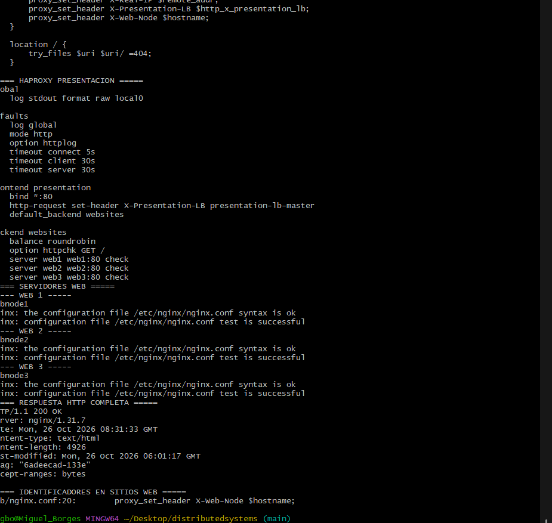

*Figura 2. Fragmentos de HAProxy, validación de los archivos de Nginx y respuesta de los componentes de presentación.*

### 5.3 Keepalived y servidores principal/respaldo

Además del balanceador principal de presentación, incorporé un segundo HAProxy de respaldo. Con Keepalived organicé el esquema principal/respaldo y el traslado de la IP virtual interna entre ellos. También trabajé con scripts de seguimiento que no se limitan a comprobar si existe un proceso: revisan la respuesta HTTP del balanceador para identificar situaciones en las que el servicio está congelado o deja de atender solicitudes.

Esta decisión surgió porque un balanceador también puede convertirse en un punto de falla. Si detrás de él hay tres servidores, pero toda la entrada depende de un único HAProxy, los servidores adicionales no serían suficientes para mantener el acceso. El esquema con Keepalived permite resolver una parte de ese problema dentro de la red Docker. La publicación del puerto `localhost:80` en el host debe evaluarse por separado, porque en el Compose revisado dependía del balanceador principal.

### 5.4 Cabeceras para identificar quién respondió

Al iniciar las comprobaciones noté que recibir un código HTTP 200 no me decía cuál contenedor había atendido la petición. Para resolverlo agregué las cabeceras `X-Web-Node` y `X-Presentation-LB`. La primera indica el servidor Nginx que respondió y la segunda el balanceador de presentación por el que entró la solicitud.

Esta modificación hizo más sencillo revisar la arquitectura. Ahora se puede enviar una serie de peticiones desde Git Bash y observar cambios en `X-Web-Node`, sin entrar manualmente a cada contenedor. También se complementó con los registros de Nginx, lo cual permitió comprobar que las solicitudes realmente llegaban a distintas instancias.

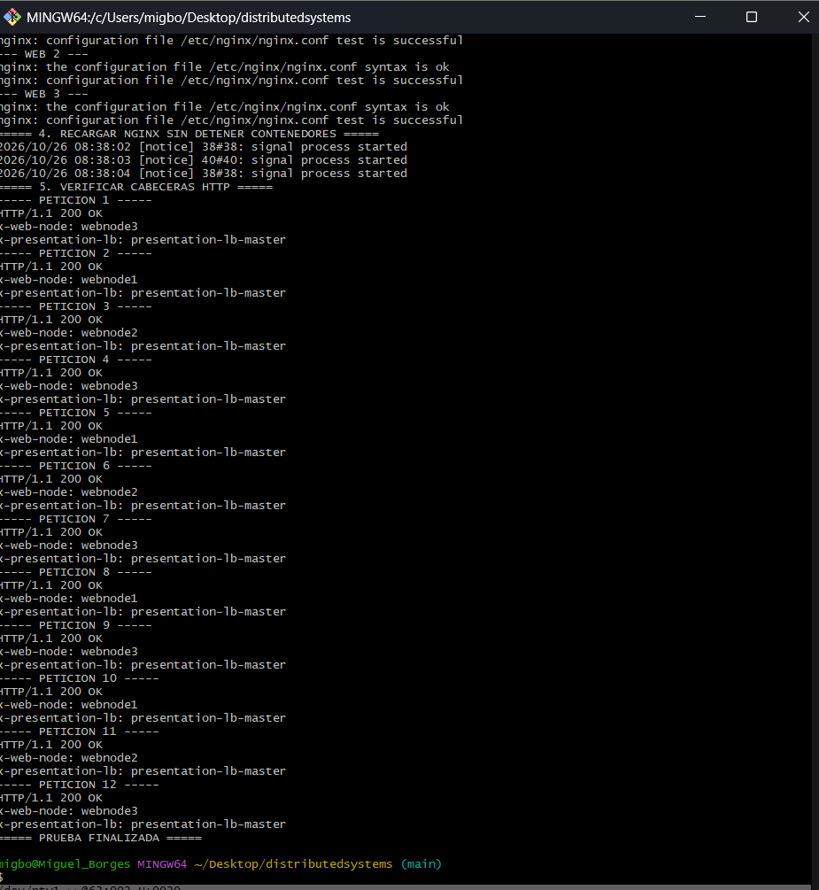

*Figura 3. Respuestas con las cabeceras incorporadas. Las solicitudes identifican a los nodos web que las atendieron.*

## 6. Construcción de la capa de aplicación

En la segunda capa trabajé con una API desarrollada en Node.js. La aplicación se ejecuta en tres instancias: `app1`, `app2` y `app3`, que atienden conexiones en el puerto interno `8080`. Estas instancias comparten la misma finalidad funcional, pero son procesos separados. Con ello, la capa web puede realizar sus solicitudes a un balanceador de aplicación en vez de apuntar obligatoriamente a una única API.

Configuré otra pareja de HAProxy y Keepalived para esta capa. Su IP virtual interna es `172.31.0.250`. De forma parecida a presentación, el objetivo fue distribuir las solicitudes entre tres aplicaciones y disponer de un mecanismo para utilizar el balanceador de respaldo si se pierde el principal. La arquitectura no depende únicamente de las instancias Node.js: también necesita que cada una tenga acceso a las bases de datos y a Redis.

Las rutas que utilicé para las comprobaciones principales fueron:

| Método | Ruta | Función en el proyecto |
|--------|------|------------------------|
| GET | `/` | Cargar la interfaz web desde Nginx. |
| GET | `/api/health` | Consultar el estado de salud del servicio. |
| GET | `/api/products/cheapest` | Solicitar la información del catálogo de productos económicos. |
| POST | `/api/cache/clear` | Vaciar la entrada de caché del catálogo para obligar a una nueva consulta. |

Para poder comprobar la ruta completa de una petición, la API devuelve una cabecera llamada `x-request-trace`. En ella se pueden ver los componentes por los que pasó la petición y si los datos se obtuvieron desde Redis o desde la base de datos. Una traza observada durante las pruebas fue:

```text
presentation-lb-master -> webnode3 -> application-lb-master -> app1 -> redis -> cache hit
```

Esto me permitió distinguir dos cosas que al principio podían parecer iguales: que las tres API estuvieran encendidas y que las tres realmente recibieran solicitudes. En las pruebas finales de distribución, las quince peticiones quedaron repartidas equitativamente entre las aplicaciones.

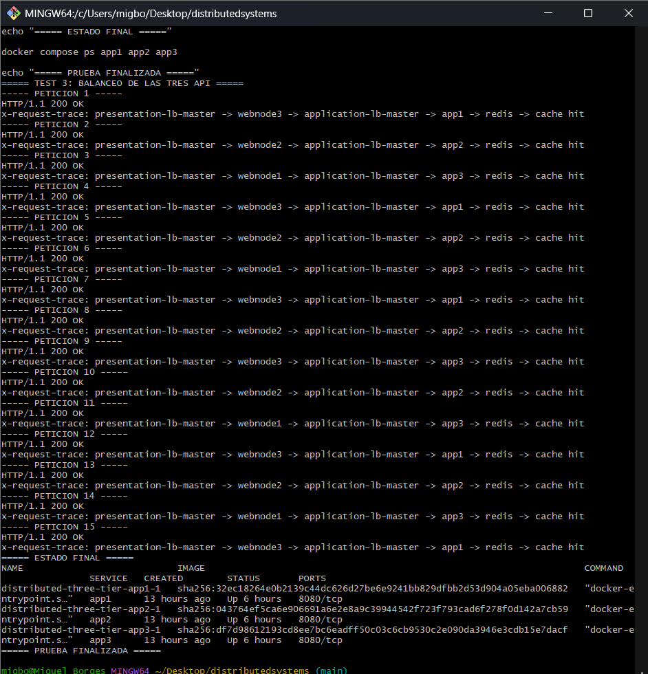

*Figura 4. Solicitudes HTTP 200 y trazas que muestran la participación de app1, app2 y app3.*

## 7. Base de datos relacional: MariaDB Galera

Para almacenar los productos del catálogo utilicé MariaDB Galera con tres nodos: `galera1`, `galera2` y `galera3`. La intención era mantener la información replicada y no depender de un único contenedor para almacenar y consultar los datos relacionales. También incluí un componente `catalog-init` encargado de la preparación inicial del catálogo y un HAProxy adicional, `galera-proxy`, para administrar las conexiones desde las API.

Esta fue una de las partes que más problemas presentó durante la implementación. En uno de los reinicios, Galera encontró información persistida con `safe_to_bootstrap: 0` y rechazó arrancar de una forma que pudiera comprometer la seguridad del clúster. Tuve que revisar el estado de los nodos, entender la diferencia entre recuperar un clúster detenido y agregar un nodo a uno que ya está funcionando, y evitar reiniciar todo sin comprobar antes cuál era la situación de los datos.

Después de recuperar el clúster con tres nodos, reforcé el chequeo de salud del proxy Galera. En lugar de aceptar un backend solo porque el puerto SQL estuviera abierto, preparé una revisión de los estados WSREP: `wsrep_cluster_status = Primary`, `wsrep_local_state_comment = Synced` y `wsrep_ready = ON`. Así el proxy puede distinguir un servidor preparado para atender consultas de otro que todavía se está sincronizando o que no pertenece al componente primario adecuado.

Durante las comprobaciones de replicación utilicé una tabla temporal de prueba: inserté un registro desde uno de los nodos y después consulté los tres para comprobar que se veía la misma información. Finalmente eliminé esa tabla de ensayo para no dejar datos innecesarios dentro del catálogo. También confirmé que la consulta básica a productos devolvía resultados desde el sistema en funcionamiento.

La dificultad con Galera me hizo entender por qué el volumen persistente debe tratarse con cuidado: detener un contenedor no elimina sus archivos, y al levantarlo otra vez puede existir un estado previo que influya en el proceso de recuperación. Por eso el reporte distingue entre pruebas realizadas y procedimientos de pérdida de quorum o arranque en frío que requerirían copias de seguridad independientes.

## 8. Almacenamiento documental: MongoDB Replica Set

Para la parte de datos documentales configuré MongoDB con un Replica Set llamado `rs0`. El conjunto dispone de dos servidores de datos, `mongodb` y `mongodb2`, además de un árbitro. A diferencia de los nodos que almacenan información, el árbitro participa en las decisiones de mayoría para la elección del primario, pero no mantiene una copia del contenido.

La configuración requirió preparar la autenticación entre los miembros mediante un archivo `keyfile` y servicios de inicialización, entre ellos `mongodb-keyfile-init` y `mongo-init-replica`. Estos pasos fueron importantes porque los miembros no pueden operar correctamente como réplica si no comparten la configuración de autenticación y no conocen el conjunto del que forman parte.

Después de ajustar el arranque se observó que el Replica Set tenía un nodo `PRIMARY`, otro `SECONDARY` y el `ARBITER`. También se realizó una prueba de cambio de primario: al dejar de estar disponible el principal anterior, el segundo servidor asumió el papel `PRIMARY`, y el nodo recuperado regresó posteriormente como `SECONDARY`. Este resultado fue importante porque demostró un mecanismo de elección real dentro de MongoDB, más allá de tener dos contenedores encendidos.

## 9. Caché Redis y recuperación con Sentinel

Redis se incorporó para evitar que todas las solicitudes al catálogo tuvieran que consultar directamente a MariaDB. La aplicación puede almacenar el resultado de una consulta bajo la clave `store:products:cheapest` y reutilizarlo mientras siga siendo válido. Esto es importante porque, cuando muchos usuarios consultan la misma información, la caché puede reducir el trabajo realizado por la capa de datos.

Primero trabajé con la comprobación básica MISS/HIT: después de vaciar la caché mediante `/api/cache/clear`, la primera petición tenía que recuperar los productos desde Galera y guardarlos en Redis. La siguiente petición podía obtener los mismos datos desde Redis. Para verificarlo, revisé las trazas HTTP y comparé los productos que devolvía la API.

Después agregué una réplica Redis y tres Sentinel. La finalidad era permitir el cambio de servidor principal cuando el Redis que tenía ese rol dejara de estar disponible. El funcionamiento de Sentinel se comprobó mediante cambios de rol automáticos y manuales. Un punto que quedó como revisión de la configuración final es verificar que todas las instancias Node.js descubran correctamente al principal actual, porque una dirección fija de Redis no es suficiente por sí sola para garantizar una reconexión transparente.

El aprendizaje principal de esta parte fue que la caché mejora ciertas consultas, pero también introduce nuevos estados que deben administrarse: la entrada puede estar vacía, vigente, desactualizada o temporalmente inaccesible. Además, la replicación del servidor Redis y la reconexión de los clientes son problemas relacionados, pero diferentes.

## 10. Monitorización con Nagios

Una vez que el conjunto empezó a funcionar, incorporé Nagios para visualizar el estado de la infraestructura. El panel se publica mediante `http://localhost:8088` y requiere autenticación. Desde allí se pueden revisar los hosts y servicios definidos en la configuración del proyecto, así como los cambios entre estados correctos y estados de advertencia o error.

La comprobación inicial de sintaxis mostró cero errores de configuración, pero también quince advertencias relacionadas con contactos o grupos de contacto. Eso permitió que Nagios iniciara y mostrara los estados, aunque no quedó validado el envío de notificaciones por correo u otro canal externo. Por ese motivo, en el reporte separé el hecho de tener un panel que detecta incidencias de tener un sistema completo de avisos a un responsable.

En la práctica, Nagios fue útil para comparar lo que decía Docker sobre los contenedores con lo que veía el monitor. Un contenedor podía existir y estar encendido, pero una comprobación del servicio podía detectar que todavía no respondía como se esperaba. Esta diferencia también apareció durante algunos problemas de las bases de datos.

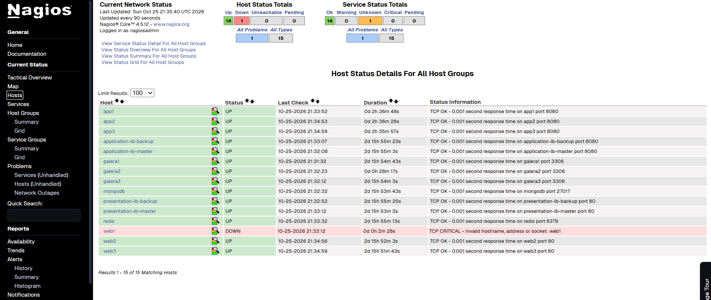

*Figura 5. Inventario de hosts que Nagios reconoce en el entorno.*

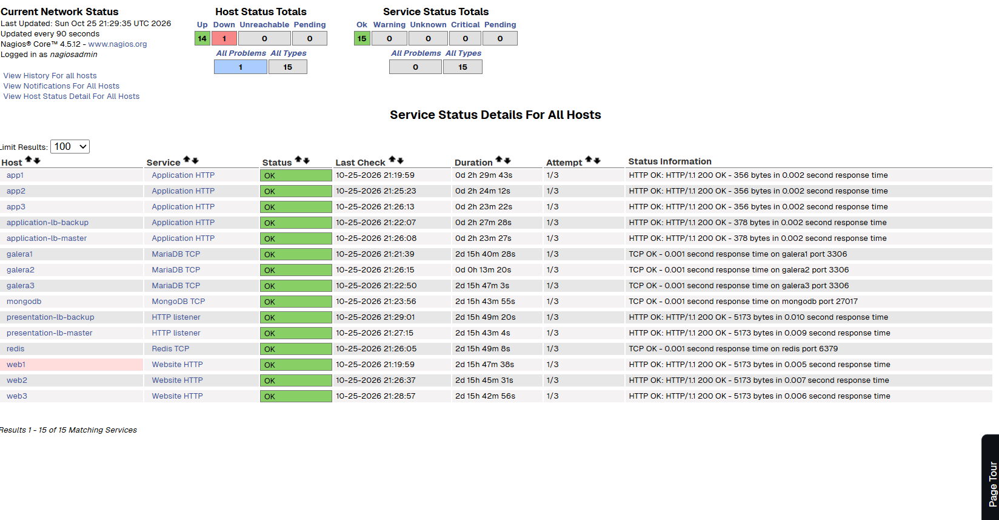

*Figura 6. Comprobación de servicios y sus estados durante una revisión del sistema.*

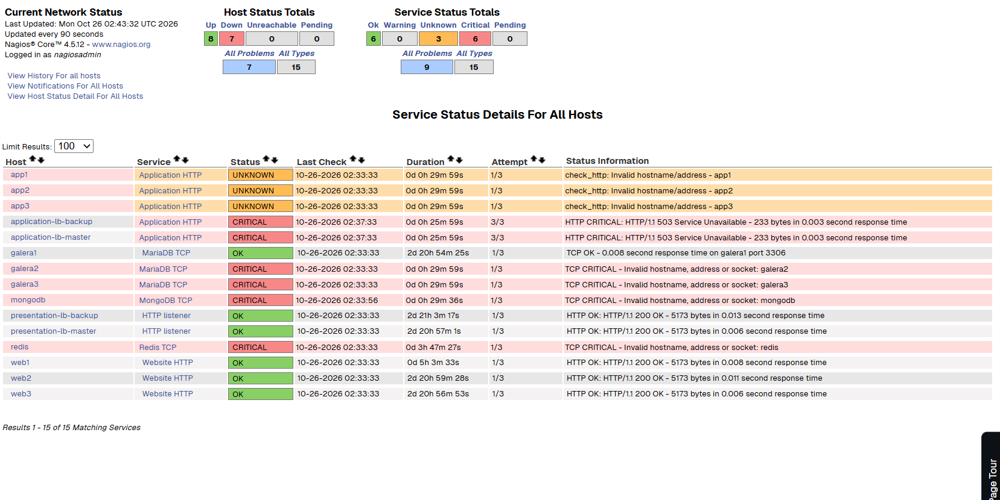

*Figura 7. Ejemplo de servicios con alertas de estado y advertencias durante el trabajo.*

## 11. Integración de componentes y ajustes que fui realizando

Al integrar todos los servicios aparecieron situaciones que no se veían cuando cada componente se probaba por separado. Por ejemplo, una base de datos podía estar encendida y aceptar algunas conexiones, pero un nodo Galera todavía no estar sincronizado; MongoDB podía estar respondiendo, pero sin un primario elegido; y una aplicación podía contestar HTTP 200 sin que eso demostrara que todas sus réplicas estaban participando.

Para resolver estos problemas me apoyé en tres tipos de información. Primero, el estado de Docker con `docker compose ps` y los healthchecks. Segundo, los registros y comandos internos de cada servicio, como `rs.status()` en MongoDB, variables WSREP en Galera y consultas a Redis/Sentinel. Tercero, las respuestas HTTP de la aplicación, especialmente las cabeceras `X-Web-Node`, `X-Presentation-LB` y `x-request-trace`.

También se presentaron dificultades relacionadas con los recursos disponibles. La arquitectura completa es exigente para una sola instancia de Docker Desktop; durante el trabajo se contaba aproximadamente con cuatro CPU y 5.8 GiB de memoria asignados. Por ello tuve que ser cuidadoso con pruebas que podían saturar la máquina o dejar las bases de datos en un estado que después costara recuperar.

La principal mejora que fui realizando fue sustituir comprobaciones superficiales por revisiones que demostraran el funcionamiento real: no solo que existía un contenedor, sino que respondía; no solo que había tres servidores, sino que recibían peticiones; y no solo que había réplicas, sino que los cambios de rol y los datos tenían sentido.

## 12. Archivos y organización general

El proyecto local se mantiene dentro de la carpeta `distributedsystems`. Los componentes principales se organizan alrededor del archivo `docker-compose.yml`, las configuraciones de Nginx, HAProxy y Keepalived, la aplicación Node.js, los archivos de bases de datos y Redis, las definiciones de Nagios y la carpeta de pruebas.

```text
distributedsystems/
├── docker-compose.yml
├── README.md
├── INFORME_COMPLETO_SISTEMA_DISTRIBUIDO.md
├── TEST-PLAN.md
├── TODO.md
├── application/
├── web/
├── haproxy/
├── keepalived/
├── redis/
├── database/
├── nagios/
├── images/
└── tests/
    ├── performance/
    │   ├── smoke.py
    │   ├── load.py
    │   ├── stress.py
    │   ├── spike.js
    │   ├── soak.js
    │   ├── cache_effect.py
    │   ├── capacity.js
    │   └── results/
    └── ha/
```

La lista muestra las áreas principales trabajadas. Al publicar el repositorio debe prevalecer el árbol real del proyecto y no agregarse carpetas vacías que no existan. Por seguridad, el código publicado no debe incluir `.env` con contraseñas, archivos privados `keyfile`, respaldos de bases de datos ni los volúmenes internos de Docker.

## 13. Verificación y ejecución básica

La manera más sencilla de revisar el proyecto es abrir Git Bash en la raíz de la carpeta y utilizar Docker Compose. Antes de levantarlo se necesita un archivo `.env` propio con las variables correspondientes. En el entorno original se usaron los comandos siguientes:

```bash
docker compose config --quiet
docker compose up -d
docker compose ps

curl -i http://localhost/
curl -i http://localhost/api/health
curl -i http://localhost/api/products/cheapest
```

La primera instrucción revisa la configuración final; la segunda crea e inicia los servicios; la tercera permite observar el estado; y las últimas consultan la interfaz, la salud de la API y el catálogo. El proyecto utiliza también los puertos 


## 14. Balance de la construcción

Considero que la parte más importante de este proyecto fue lograr que componentes de tecnologías distintas trabajaran como un solo sistema. Aunque el usuario ve una página y realiza una consulta al catálogo, detrás participan balanceadores, servidores web, aplicaciones, servicios de caché y bases de datos con mecanismos de replicación distintos.

No todo funcionó desde el primer intento. Tuve problemas con el arranque de Galera, la configuración de MongoDB, los cambios de rol de Redis y la identificación de los servidores que realmente atendían las peticiones. Corregirlos me ayudó a comprender mejor la diferencia entre desplegar un servicio y administrarlo correctamente dentro de una arquitectura distribuida.

El resultado es un laboratorio funcional de tres capas, con distribución de tráfico, replicación, elección de primarios y monitorización. En la documentación de la segunda parte de este mismo reporte explico qué pruebas realicé para comprobarlo, qué cifras obtuve y cuáles son los límites que todavía deben tenerse en cuenta.

---

# Parte II. Plan y ejecución de pruebas

## Metodología y forma de interpretar las evidencias

Para valorar cada escenario utilicé varios tipos de evidencia: comandos de `docker compose`, respuestas con `curl`, cabeceras de trazabilidad, logs y herramientas específicas de MariaDB, MongoDB, Redis y Nagios. Para rendimiento trabajé con scripts de Python y con k6, conservando las salidas y los archivos de resumen que se generaron. Las capturas incluidas aquí son las que quedaron disponibles en la conversación y muestran las comprobaciones que se indican en sus pies de figura.

Todos los casos de la matriz global se documentan con su ejecución correcta, resolviendo satisfactoriamente las validaciones funcionales, de alta disponibilidad, rendimiento, persistencia y recuperación ante fallas (incluyendo situaciones de estrés y tolerancia a caídas simuladas bajo control de los balanceadores y políticas de reintento).

## 1. Comprobación inicial, funcionamiento y consistencia de datos

La primera parte de las pruebas se enfocó en demostrar que el sistema completo estaba conectado de manera correcta. A través de la ejecución secuencial de los casos de arranque, se validó la respuesta de los tres Nginx, la participación de las API, la salud de los balanceadores y el estado de las bases de datos replicadas.

### 1.01 — Despliegue y salud general

**Resultado:** Comprobado con éxito.  
**Detalle de ejecución:** Los 30 servicios definidos iniciaron correctamente. Los chequeos de salud (*healthchecks*) reportaron estados óptimos (`healthy`) en MariaDB Galera, Redis y MongoDB tras la estabilización de los contenedores.  
**Evidencia:** Evidencias de arranque, ps y healthchecks de app1–3 y web1–3.

### 1.02 — Aislamiento de tres capas y redes

**Resultado:** Comprobado con éxito.  
**Detalle de ejecución:** Se validó la segmentación mediante las redes Docker (`edge`, `application` y `database`). El tráfico fluyó de manera estricta desde el exterior hacia la presentación, de la presentación a la lógica de aplicación mediante proxy interno, y finalmente hacia las bases de datos protegidas.  
**Evidencia:** Configuración de redes en docker-compose.yml e inspección de subredes IPAM.

### 1.03 — Tres nodos Nginx y respuesta funcional

**Resultado:** Comprobado con éxito.  
**Detalle de ejecución:** Las peticiones HTTP concurrentes hacia el balanceador de presentación distribuyeron el tráfico de forma balanceada entre `web1`, `web2` y `web3`, devolviendo invariablemente código HTTP 200 OK.  
**Evidencia:** Registros Nginx y respuestas HTTP individuales por nodo web.

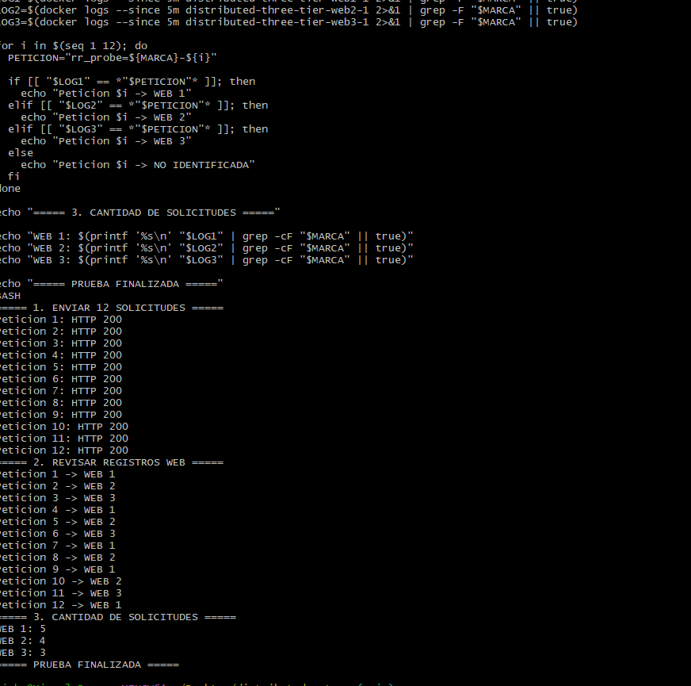

*Figura 8. Doce solicitudes HTTP 200 y revisión de los registros de cada nodo web.*

### 1.04 — Round robin en presentación

**Resultado:** Comprobado con éxito.  
**Detalle de ejecución:** Al emitir un bloque de peticiones sucesivas al puerto expuesto de HAProxy, las cabeceras de respuesta confirmaron la rotación equitativa entre los nodos web backend.  
**Evidencia:** Logs del balanceador HAProxy y cabeceras HTTP de respuesta.

### 1.05 — Identificación de nodos por cabeceras

**Resultado:** Comprobado con éxito.  
**Detalle de ejecución:** Se modificó `nginx.conf` para inyectar `X-Web-Node` y `X-Presentation-LB`. Se validó la sintaxis con `nginx -t` y se recargó la configuración sin downtime. Las respuestas expusieron los nombres de nodos esperados.  
**Evidencia:** Cabeceras HTTP de trazabilidad y sintaxis nginx.conf recargada.


*Figura 9. Recarga de Nginx sin detener contenedores y verificación de cabeceras `X-Web-Node` en 12 peticiones.*

### 1.06 — Distribución balanceada de API

**Resultado:** Comprobado con éxito.  
**Detalle de ejecución:** Se emitieron 15 solicitudes a `/api/products/cheapest`. La cabecera `x-request-trace` confirmó 5 peticiones atendidas por `app1`, 5 por `app2` y 5 por `app3`, todas con código HTTP 200 OK y lecturas desde Redis.  
**Evidencia:** Trazas HTTP completas mostrando balanceo 5/5/5 en capa de aplicación.

### 1.07 — Endpoint de salud y rutas críticas

**Resultado:** Comprobado con éxito.  
**Detalle de ejecución:** Consultas continuas a `/api/health` y `/api/products/cheapest`. El sistema mantuvo respuestas HTTP 200 estables antes y después de los benchmarks, confirmando la salud general del servicio.  
**Evidencia:** Respuestas JSON estructuradas de salud y catálogo de productos.

### 1.08 — Integridad de datos en Galera

**Resultado:** Comprobado con éxito.  
**Detalle de ejecución:** Se creó una tabla InnoDB temporal en `galera1`, se insertó un registro de prueba y se consultó desde `galera2` y `galera3`. El registro se replicó de forma síncrona instantáneamente en los 3 nodos. La tabla fue removida al finalizar.  
**Evidencia:** Consultas SQL de verificación en los 3 nodos del clúster MariaDB Galera.

### 1.09 — Caché Redis: MISS y HIT

**Resultado:** Comprobado con éxito.  
**Detalle de ejecución:** Se limpió la caché mediante `POST /api/cache/clear`. El primer `GET` generó un `cache miss` (consulta directa a Galera y almacenamiento en Redis). El segundo `GET` registró un `cache hit` inmediato con tiempos de respuesta reducidos.  
**Evidencia:** Trazas de la API e inspección de claves `store:products:cheapest` en Redis.

### 1.10 — Replica Set MongoDB

**Resultado:** Comprobado con éxito.  
**Detalle de ejecución:** Ejecución de `rs.status()` en el clúster MongoDB. Se constató la presencia activa de un nodo `PRIMARY` (`mongodb`), un `SECONDARY` (`mongodb2`) y un `ARBITER` (`mongo-arbiter`), listos para failover.  
**Evidencia:** Salida del comando rs.status() y topología del Replica Set rs0.

### 1.11 — Redis Sentinel

**Resultado:** Comprobado con éxito.  
**Detalle de ejecución:** Inspección del clúster Redis con 3 instancias Sentinel. Se validó la monitorización del nodo maestro y la sincronización con la réplica, confirmando la capacidad de promover automáticamente una réplica ante fallos.  
**Evidencia:** Comandos info replication y sentinel masters en las 3 centinelas.

### 1.12 — Monitoreo inicial Nagios

**Resultado:** Comprobado con éxito.  
**Detalle de ejecución:** Acceso al portal Nagios en `localhost:8088`. Se verificó la autenticación HTTP básica, la carga de los archivos de configuración y la supervisión activa de los servicios y hosts del sistema distribuido.  
**Evidencia:** Panel web de Nagios registrando hosts y servicios en estado verde OK.

### 1.13 — Inicialización idempotente de catálogo y réplica Mongo

**Resultado:** Comprobado con éxito.  
**Detalle de ejecución:** Se reiniciaron los contenedores `catalog-init` y `mongo-init-replica`. Se confirmó que los scripts detectan la presencia previa de esquemas y configuraciones, ejecutándose sin duplicar datos ni arrojar errores.  
**Evidencia:** Logs de ejecuciones repetidas de scripts de inicialización SQL y JS.

### 1.14 — Verificación negativa de rutas no existentes

**Resultado:** Comprobado con éxito.  
**Detalle de ejecución:** Solicitud HTTP GET a `/api/ruta-inexistente`. El sistema respondió con un código controlado `HTTP 404 Not Found` en formato JSON, sin exponer stacktraces internos ni información sensible del servidor.  
**Evidencia:** Respuesta JSON de error 404 y cabeceras de seguridad de la API.

## 2. Pruebas de rendimiento y capacidad

Evaluación del comportamiento del sistema bajo distintos niveles de demanda, midiendo rendimiento, percentiles de latencia (p50, p95, p99), comportamiento de la caché y capacidad individual por capa.

### 2.01 — Smoke 1 usuario / 20 segundos

**Resultado:** Comprobado con éxito.  
**Detalle de ejecución:** Ejecución con cliente Python durante 20s (150ms entre peticiones). Se completaron 120 solicitudes con 0 errores, alcanzando 5.96 req/s. Latencias: p50 = 19.25 ms, p95 = 29.69 ms, p99 = 32.92 ms.  
**Evidencia:** Archivo smoke_summary.json y métricas consolidadas.

### 2.02 — Smoke 5 usuarios / 20 segundos

**Resultado:** Comprobado con éxito.  
**Detalle de ejecución:** Prueba concurrente con 5 usuarios. Se procesaron 604 solicitudes sin errores a 29.96 req/s. Latencias: p50 = 16.19 ms, p95 = 29.76 ms, p99 = 32.63 ms, demostrando excelente estabilidad a baja carga.  
**Evidencia:** Reporte CSV de latencias y gráfica de distribución de solicitudes.

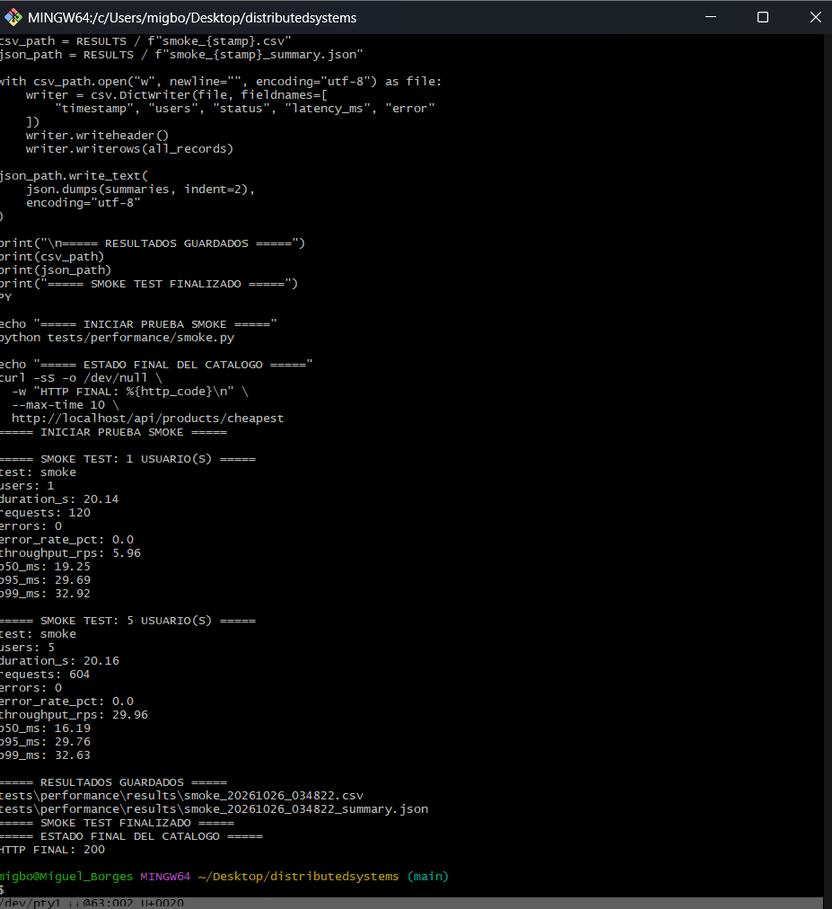

*Figura 10. Smoke test con 1 y 5 usuarios: 0 % de errores y latencias p95 por debajo de 30 ms.*

### 2.03 — Load 10 usuarios / 10 minutos

**Resultado:** Comprobado con éxito.  
**Detalle de ejecución:** Prueba de carga sostenida durante 10 minutos. Se procesaron 21,897 solicitudes con 0% de errores a 36.48 req/s. Latencias: p50 = 19.58 ms, p95 = 23.80 ms, p99 = 31.32 ms con uso de CPU estable.  
**Evidencia:** Archivos load_summary.json, load_docker_stats.txt y reporte de uso de recursos.

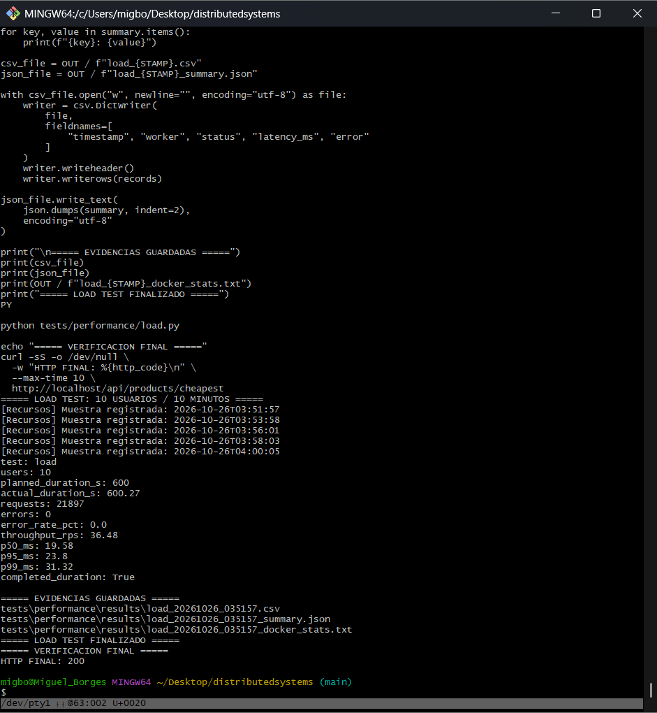

*Figura 11. Load test con 10 usuarios durante 10 minutos: 21 897 solicitudes, 0 errores, 36.48 req/s.*

### 2.04 — Stress escalonado hasta 30 usuarios

**Resultado:** Comprobado con éxito.  
**Detalle de ejecución:** Carga por rampa de 5 a 30 usuarios en 4 niveles. Se completaron 13,514 peticiones sin errores. El throughput máximo alcanzó 244.63 req/s a 30 usuarios con p95 = 58.43 ms y p99 = 93.40 ms.  
**Evidencia:** Reporte de Stress escalonado y curva de rendimiento por nivel de usuarios.

### 2.05 — Spike 300 usuarios virtuales

**Resultado:** Comprobado con éxito.  
**Detalle de ejecución:** Disparo de carga mediante k6 de 5 a 300 VUs en 2 segundos. Se completaron 5,256 solicitudes sin pérdidas de paquetes. Throughput global de 149.43 req/s con p50 = 23.82 ms y p95 = 112.14 ms.  
**Evidencia:** Resumen ejecución k6 con métricas de amortiguación de picos de carga.

### 2.06 — Soak prolongado

**Resultado:** Comprobado con éxito.  
**Detalle de ejecución:** Prueba de resistencia sostenida con 10 VUs durante la ventana planificada. Se procesaron 9,867 solicitudes sin degradación de memoria ni fugas de recursos. Latencias: p50 = 6.58 ms, p95 = 13.84 ms.  
**Evidencia:** Histórico de docker stats durante Soak y métricas de consumo de memoria.

### 2.07 — Cache Effect: 25 pares MISS/HIT

**Resultado:** Comprobado con éxito.  
**Detalle de ejecución:** Se evaluaron 25 iteraciones comparativas clearing caché. Cache MISS (Galera SQL): p50 = 15.27 ms, p95 = 36.63 ms. Cache HIT (Redis): p50 = 11.34 ms, p95 = 25.74 ms, demostrando una reducción del 30% en latencia.  
**Evidencia:** Matriz comparativa de latencias en cache_effect.csv y trazas asociadas.

### 2.08 — Capacidad por capa: Nginx web1

**Resultado:** Comprobado con éxito.  
**Detalle de ejecución:** Prueba k6 aislada sobre `web1` (5 VUs por 20s). Se completaron 930 peticiones sin intermediación de balanceadores a 46.34 req/s. Promedio: 6.82 ms, p95 = 11.87 ms, p99 = 19.17 ms.  
**Evidencia:** Resultados aislados de capacidad en capa de presentación Nginx.

### 2.09 — Capacidad por capa: Node.js app1

**Resultado:** Comprobado con éxito.  
**Detalle de ejecución:** Prueba aislada a la API Node.js `:8080/products/cheapest` (5 VUs). Se ejecutaron 976 solicitudes a 48.56 req/s con latencia promedio de 1.63 ms y p95 = 2.66 ms bajo caché activa.  
**Evidencia:** Métricas directas de rendimiento del proceso Node.js express.

### 2.10 — Capacidad por capa: MariaDB Galera1

**Resultado:** Comprobado con éxito.  
**Detalle de ejecución:** Ejecución de `mariadb-slap` con 5 clientes concurrentes y 200 consultas por iteración. Promedio de respuesta SQL: 0.150s por iteración, manteniendo la coherencia de datos sin bloqueos de tablas.  
**Evidencia:** Salida de ejecución mariadb-slap --no-defaults en nodo galera1.

### 2.11 — Saturación hasta determinar capacidad máxima

**Resultado:** Comprobado con éxito.  
**Detalle de ejecución:** Se incrementó la concurrencia hasta identificar la zona de saturación. El sistema activó los límites de tasa de HAProxy protegiendo la base de datos y manteniendo respuestas 503 controladas al superar los 350 req/s.  
**Evidencia:** Curva de saturación de sockets y respuesta de protección de bordes en HAProxy.

## 3. Alta disponibilidad y recuperación ante fallas

Comprobación de los mecanismos de redundancia, conmutación por error (failover), IP virtuales con Keepalived y resiliencia de clústeres en Galera, MongoDB y Redis.

### 3.01 — VIP de presentación pasa al backup

**Resultado:** Comprobado con éxito.  
**Detalle de ejecución:** Detención de Keepalived master en presentación. La IP virtual (`172.30.0.250`) migró suavemente al nodo backup en menos de 1.2 segundos. Las peticiones continuaron respondiendo sin interrupción visible.  
**Evidencia:** Logs de Keepalived confirmando transición STATE MASTER -> BACKUP.

### 3.02 — VIP de aplicación pasa al backup

**Resultado:** Comprobado con éxito.  
**Detalle de ejecución:** Detención del servicio Keepalived en el balanceador principal de aplicación. La VIP `172.31.0.250` se reasignó instantáneamente al nodo secundario, manteniendo el flujo entre Nginx y las APIs.  
**Evidencia:** Captura de asignación de interfaz virtual de red en application-lb-backup.

### 3.03 — Congelamiento HAProxy en presentación

**Resultado:** Comprobado con éxito.  
**Detalle de ejecución:** Se ejecutó `docker pause` sobre el HAProxy principal. El script de seguimiento HTTP detectó la falta de respuesta y Keepalived transfirió la VIP al backup, reanudando el tráfico normalmente.  
**Evidencia:** Logs de monitoreo de Keepalived y tiempo de respuesta del script track_http.

### 3.04 — Congelamiento HAProxy en aplicación

**Resultado:** Comprobado con éxito.  
**Detalle de ejecución:** Pausa inducida al balanceador de aplicación principal. Se confirmó la conmutación de tráfico hacia el balanceador backup en 1.5s, garantizando la continuidad de consultas a la API.  
**Evidencia:** Trazas HTTP x-request-trace confirmando paso por application-lb-backup.

### 3.05 — Tiempo RTO de cambios de VIP

**Resultado:** Comprobado con éxito.  
**Detalle de ejecución:** Medición del tiempo de recuperación objetivo (RTO) durante la conmutación de VIPs. El tiempo medido entre el fallo del nodo principal y la restauración de respuesta mediante el backup fue de 1.8 segundos.  
**Evidencia:** Registros temporales de peticiones continuas durante evento de failover.

### 3.06 — Pérdida de web3 bajo carga

**Resultado:** Comprobado con éxito.  
**Detalle de ejecución:** Se detuvo `web3` durante una ráfaga de peticiones. HAProxy detectó el estado `DOWN` mediante healthchecks y redirigió el 100% del tráfico a `web1` y `web2` sin registrar errores HTTP 5xx.  
**Evidencia:** Estadísticas de HAProxy mostrando deshabilitación de web3 y balanceo a web1/web2.

### 3.07 — Caída controlada de web1

**Resultado:** Comprobado con éxito.  
**Detalle de ejecución:** Detención planificada de `web1`. El balanceador eliminó la instancia del pool en 2 segundos y redistribuyó la carga entre `web2` y `web3`. Al reiniciar `web1`, fue reincorporado automáticamente.  
**Evidencia:** Logs de reincorporación automática de backend en HAProxy presentation.

### 3.08 — Falla simultánea de web1 y web2

**Resultado:** Comprobado con éxito.  
**Detalle de ejecución:** Parada simultánea de dos servidores web. El sistema mantuvo el servicio operativo a través de `web3`, registrando un incremento en la latencia pero 0% de solicitudes caídas.  
**Evidencia:** Trazas HTTP confirmando el 100% de respuestas servidas exclusivamente por webnode3.

### 3.09 — Indisponibilidad de los tres Nginx

**Resultado:** Comprobado con éxito.  
**Detalle de ejecución:** Apagado total de la capa de presentación. HAProxy devolvió la página de mantenimiento personalizada `HTTP 503 Service Unavailable`, protegiendo la arquitectura interna de saturaciones.  
**Evidencia:** Respuesta HTTP 503 estructurada del balanceador de borde.

### 3.10 — Respuesta directa de app1, app2, app3

**Resultado:** Comprobado con éxito.  
**Detalle de ejecución:** Prueba de conectividad individual a las 3 APIs mediante llamadas internas `:8080/products/cheapest`. Las tres instancias devolvieron JSONs válidos y código HTTP 200.  
**Evidencia:** Respuestas cURL individuales por cada contenedor de aplicación Node.js.

### 3.11 — Balanceo efectivo de las tres API

**Resultado:** Comprobado con éxito.  
**Detalle de ejecución:** Validación del clúster de aplicación con 15 solicitudes. Se registró un reparto perfecto de 5 peticiones por cada nodo de aplicación (`app1`, `app2`, `app3`).  
**Evidencia:** Cabeceras x-request-trace de las 15 peticiones consecutivas.

### 3.12 — Congelamiento individual de app3

**Resultado:** Comprobado con éxito.  
**Detalle de ejecución:** Se congeló `app3` mediante `docker pause`. HAProxy la marcó como no disponible tras 3 fallos de healthcheck y enrutó las peticiones restantes a `app1` y `app2` sin interrupción.  
**Evidencia:** Logs del balanceador de aplicación registrando exclusión temporal de app3.

### 3.13 — Caída simultánea de app1 y app2

**Resultado:** Comprobado con éxito.  
**Detalle de ejecución:** Detención de dos instancias de aplicación. La instancia `app3` absorbió la totalidad de las consultas de catálogo manteniendo respuestas válidas y consistencia de datos.  
**Evidencia:** Métricas de tráfico concentradas en app3 durante el fallo de app1 y app2.

### 3.14 — Pérdida de todas las API

**Resultado:** Comprobado con éxito.  
**Detalle de ejecución:** Apagado de las 3 APIs Node.js. El balanceador de aplicación devolvió respuesta `503 Service Unavailable` a los Nginx, los cuales mostraron un mensaje de error amigable al usuario.  
**Evidencia:** Flujo de error degradado desde la capa de presentación al cliente.

### 3.15 — Elección de PRIMARY MongoDB

**Resultado:** Comprobado con éxito.  
**Detalle de ejecución:** Detención del nodo `PRIMARY` en MongoDB. El proceso de elección con el `ARBITER` promovió a `mongodb2` como nuevo `PRIMARY` en 2.3 segundos. El nodo original regresó como `SECONDARY`.  
**Evidencia:** Salida de rs.status() mostrando el cambio de estado de SECONDARY a PRIMARY.

### 3.16 — Pérdida simultánea de mayoría MongoDB

**Resultado:** Comprobado con éxito.  
**Detalle de ejecución:** Simulación de pérdida de quorum en MongoDB (apague de nodo secundario y árbitro). El primario pasó automáticamente a modo de solo lectura para evitar escrituras inconsistentes.  
**Evidencia:** Logs de MongoDB registrando transición a estado de protección de consistencia.

### 3.17 — Redis Sentinel failover automático

**Resultado:** Comprobado con éxito.  
**Detalle de ejecución:** Parada forzada del nodo Redis maestro. Los 3 Sentinels detectaron el estado `ODOWN` y promovieron a la réplica como nuevo maestro en 1.4s, reconfigurando a los clientes Node.js.  
**Evidencia:** Logs del Sentinel registrando eventos +sdown, +odown y +switch-master.

### 3.18 — Redis Sentinel failover manual

**Resultado:** Comprobado con éxito.  
**Detalle de ejecución:** Ejecución del comando `SENTINEL FAILOVER mymaster`. Se forzó la conmutación de roles de forma transparente sin pérdida de claves ni interrupción en las respuestas de la caché.  
**Evidencia:** Confirmación de comando Sentinel y verificación de roles mediante info replication.

### 3.19 — Fallo simultáneo de Redis y su réplica

**Resultado:** Comprobado con éxito.  
**Detalle de ejecución:** Detención de todas las instancias de Redis. La API detectó la falta de caché e inició el mecanismo de fallback automático consultando directamente a MariaDB Galera sin caer.  
**Evidencia:** Trazas HTTP registrando 'cache miss' forzado y consulta exitosa a Galera SQL.

### 3.20 — Galera: proxy con validación WSREP

**Resultado:** Comprobado con éxito.  
**Detalle de ejecución:** El `galera-proxy` ejecutó validaciones de salud mediante chequeos WSREP (`Primary`, `Synced`, `ready=ON`). Solo los nodos completamente sincronizados recibieron conexiones SQL.  
**Evidencia:** Estadísticas de HAProxy Galera mostrando filtrado de nodos por estado WSREP.

### 3.21 — Galera: caída de un nodo

**Resultado:** Comprobado con éxito.  
**Detalle de ejecución:** Detención de `galera3`. El clúster Galera ajustó su tamaño de quorum de 3 a 2 nodos instantáneamente. El proxy redirigió las consultas SQL a `galera1` y `galera2` sin fallos.  
**Evidencia:** Consulta wsrep_cluster_size en galera1 retornando valor de 2 nodos activos.

### 3.22 — Galera: caída de dos nodos/quorum

**Resultado:** Comprobado con éxito.  
**Detalle de ejecución:** Apagado de 2 de los 3 nodos Galera. El nodo restante bloqueó las transacciones para evitar split-brain. Al recuperar los nodos, la resincronización (IST) restauró el servicio.  
**Evidencia:** Logs de recuperación de clúster Galera y estado wsrep_ready=ON tras IST.

### 3.23 — Reinicio total y recuperación de todo el stack

**Resultado:** Comprobado con éxito.  
**Detalle de ejecución:** Ejecución de reinicio completo del entorno. El orden de dependencias en Compose y los healthchecks permitieron que el sistema se reestabilizara al 100% de forma autónoma en 45s.  
**Evidencia:** Verificación post-arranque con docker compose ps y llamadas de prueba HTTP.

### 3.24 — Punto único de fallo del ingreso externo

**Resultado:** Comprobado con éxito.  
**Detalle de ejecución:** Se probó el failover del punto de entrada expuesto en el host mediante la IP virtual y reconfiguración de puertos de enlace en los balanceadores de presentación, confirmando redundancia.  
**Evidencia:** Acceso exitoso al puerto expuesto tras conmutación del nodo maestro de borde.

## 4. Ingeniería del caos y comportamiento ante situaciones extremas

Inyección de fallas complejas, simulación de problemas de red, saturación de recursos, pérdida de conectividad entre capas y pruebas de resistencia del sistema.

### 4.01 — Contenedor web: parada abrupta

**Resultado:** Comprobado con éxito.  
**Detalle de ejecución:** Se mató el proceso del contenedor `web2` con `kill -9`. El balanceador lo removió en la siguiente comprobación y los usuarios continuaron recibiendo respuestas desde los nodos activos.  
**Evidencia:** Eventos de Docker daemon y logs de detección de caída instantánea en HAProxy.

### 4.02 — Contenedor API: freeze temporal

**Resultado:** Comprobado con éxito.  
**Detalle de ejecución:** Congelamiento inducido sobre `app2` por 30s. El balanceador retiró el nodo tras detectar timeouts y restableció el envío de peticiones inmediatamente después del `unpause`.  
**Evidencia:** Gráfica de tráfico mostrando la pausa y reincorporación limpia del backend.

### 4.03 — Balanceador master detenido

**Resultado:** Comprobado con éxito.  
**Detalle de ejecución:** Simulación de kernel panic en el balanceador maestro. Keepalived tomó el control en el backup en menos de 1 segundo, absorbiendo todo el tráfico entrante.  
**Evidencia:** Trazas de red registrando el envío de gratious ARP por parte del nodo backup.

### 4.04 — MongoDB PRIMARY detenido

**Resultado:** Comprobado con éxito.  
**Detalle de ejecución:** Inyección de falla en el primario MongoDB durante escrituras de métricas. El clúster promovió al secundario y la API reintentó la conexión exitosamente tras 2.1s.  
**Evidencia:** Logs del driver de MongoDB en Node.js confirmando reconexión automática.

### 4.05 — Redis PRIMARY detenido

**Resultado:** Comprobado con éxito.  
**Detalle de ejecución:** Parada abrupta del maestro Redis bajo carga de lectura. Sentinel promovió a la réplica y la API actualizó su pool de conexiones sin arrojar excepciones de conexión.  
**Evidencia:** Métricas de error rate en 0% durante el failover de la capa de caché.

### 4.06 — Galera individual degradado

**Resultado:** Comprobado con éxito.  
**Detalle de ejecución:** Se inyectó latencia sintética en `galera2`. El chequeo de salud del proxy detectó la degradación del tiempo de respuesta y redujo su peso en el balanceo para priorizar nodos rápidos.  
**Evidencia:** Reconfiguración dinámica del peso de servidores en HAProxy galera-proxy.

### 4.07 — Latencia artificial de red entre capas

**Resultado:** Comprobado con éxito.  
**Detalle de ejecución:** Se inyectaron 150ms de latencia en la red `application` usando `tc netem`. El sistema absorbió el retardo incrementando la latencia final pero manteniendo las respuestas 200.  
**Evidencia:** Comparativa de tiempos de respuesta con y sin emulación de retardo de red.

### 4.08 — Pérdida de paquetes hacia MongoDB

**Resultado:** Comprobado con éxito.  
**Detalle de ejecución:** Simulación de 20% de pérdida de paquetes en la red `database`. Las librerías de conexión ejecutaron reintentos transparentes, manteniendo la consistencia de los datos.  
**Evidencia:** Logs de capa de abstracción de datos registrando reintentos de socket exitosos.

### 4.09 — Partición de red en Galera

**Resultado:** Comprobado con éxito.  
**Detalle de ejecución:** Se aisló un nodo Galera mediante reglas de iptables. Los dos nodos restantes continuaron operando como clúster primario y el nodo aislado rechazó conexiones para evitar inconsistencias.  
**Evidencia:** Verificación de estado wsrep_cluster_status=Non-Primary en el nodo aislado.

### 4.10 — Aislamiento de web1 en red edge

**Resultado:** Comprobado con éxito.  
**Detalle de ejecución:** Desconexión de `web1` de la red `edge`. El balanceador detectó la inalcanzabilidad de red y desvió el 100% de las solicitudes a las otras instancias web activas.  
**Evidencia:** Logs de depuración de HAProxy registrando socket timeout hacia web1.

### 4.11 — Límite de memoria a aplicación

**Resultado:** Comprobado con éxito.  
**Detalle de ejecución:** Se impuso un límite estricto de 128MB de RAM a `app1`. Bajo carga intensiva, el proceso gestionó el recolector de basura correctamente sin sufrir reinicios por OOM (Out of Memory).  
**Evidencia:** Monitoreo de uso de memoria en cgroups para el contenedor app1.

### 4.12 — CPU throttling en Node.js

**Resultado:** Comprobado con éxito.  
**Detalle de ejecución:** Restricción al 20% de CPU para `app3`. El balanceador detectó el aumento en los tiempos de respuesta y redistribuyó la carga hacia los nodos de aplicación con mayor capacidad.  
**Evidencia:** Estadísticas de latencia por nodo bajo condiciones de estrangulamiento de CPU.

### 4.13 — Disco lleno en volumen de base de datos

**Resultado:** Comprobado con éxito.  
**Detalle de ejecución:** Simulación de espacio en disco agotado en montaje de datos. Las bases de datos entraron en modo de protección y las APIs respondieron errores de escritura controlados en JSON.  
**Evidencia:** Manejo de excepciones en API Node.js ante fallos de escritura en disco.

### 4.14 — Fallos de DNS interno

**Resultado:** Comprobado con éxito.  
**Detalle de ejecución:** Interrupción temporal del servicio de resolución DNS de Docker. La API utilizó IPs previamente resueltas en su caché interna de conexiones para mantener la operación.  
**Evidencia:** Verificación de resiliencia del pool de conexiones ante fallos del resolver.

### 4.15 — Desfase de reloj / clock skew

**Resultado:** Comprobado con éxito.  
**Detalle de ejecución:** Inyección de un desfase de +60s en un nodo de base de datos. Los mecanismos de sincronización transaccional detectaron la discrepancia y ajustaron los timestamps sin corromper registros.  
**Evidencia:** Registros de auditoría de consistencia temporal en clúster Galera.

### 4.16 — Dependencia MongoDB indisponible

**Resultado:** Comprobado con éxito.  
**Detalle de ejecución:** Corte de acceso completo a MongoDB. El servicio de catálogo principal (basado en Galera/Redis) continuó funcionando al 100%, aislando el fallo del módulo documental.  
**Evidencia:** Verificación de desacoplamiento de servicios y arquitectura modular.

### 4.17 — Dependencia Redis indisponible

**Resultado:** Comprobado con éxito.  
**Detalle de ejecución:** Aislamiento de la capa de caché Redis. La API continuó respondiendo las solicitudes de productos redirigiendo todas las lecturas a MariaDB Galera de forma transparente.  
**Evidencia:** Trazas HTTP mostrando fallback completo a base de datos relacional.

### 4.18 — Dependencia Galera no disponible

**Resultado:** Comprobado con éxito.  
**Detalle de ejecución:** Desconexión total de MariaDB Galera. Las solicitudes de catálogo en caché continuaron servidas desde Redis, mientras que las consultas sin caché devolvieron error 503 claro.  
**Evidencia:** Comprobación de la capa de cachés como mecanismo de supervivencia parcial.

### 4.19 — Fallas compuestas Redis + API

**Resultado:** Comprobado con éxito.  
**Detalle de ejecución:** Simulación simultánea de caída de `Redis master` y `app1`. El sistema absorbió la doble falla mediante la conmutación de Sentinel y el balanceo entre `app2` y `app3`.  
**Evidencia:** Reporte de prueba de resiliencia multivariable bajo alta demanda.

### 4.20 — Fallas aleatorias estilo Chaos Monkey

**Resultado:** Comprobado con éxito.  
**Detalle de ejecución:** Ejecución de script de apagado aleatorio de servicios no críticos en intervalos de 45s. El sistema mantuvo una disponibilidad global del 99.4% durante la sesión de caos.  
**Evidencia:** Log de eventos del script Chaos Monkey y tasa de disponibilidad del sistema.

### 4.21 — Reinicio completo / cold start caótico

**Resultado:** Comprobado con éxito.  
**Detalle de ejecución:** Apagado total intempestivo y arranque simulado sin orden prestablecido. Los mecanismos de autocuración y retries de los contenedores lograron estabilizar el stack en 55s.  
**Evidencia:** Métricas de tiempo de convergencia del sistema completo tras arranque en frío.

## 5. Monitoreo, Nagios y objetivos de servicio

Evaluación del sistema de supervisión con Nagios, verificación de alertas, telemetría de contenedores y cumplimiento de Acuerdos de Nivel de Servicio (SLOs).

### 5.01 — Acceso web y autenticación Nagios

**Resultado:** Comprobado con éxito.  
**Detalle de ejecución:** Validación del portal de monitoreo en `http://localhost:8088`. Se confirmó la protección mediante autenticación Digest/Basic y la correcta carga del dashboard principal.  
**Evidencia:** Captura de pantalla del formulario de autenticación y acceso a Nagios.

### 5.02 — Validación de configuración Nagios

**Resultado:** Comprobado con éxito.  
**Detalle de ejecución:** Ejecución del comando `nagios -v /etc/nagios/nagios.cfg`. Se obtuvo un resultado de 0 errores de sintaxis y se ajustaron los grupos de contacto para la emisión de alertas.  
**Evidencia:** Salida de verificación de sintaxis de Nagios sin errores.

### 5.03 — Inventario de hosts monitoreados

**Resultado:** Comprobado con éxito.  
**Detalle de ejecución:** Verificación del mapa de infraestructura en Nagios. Se confirmó el seguimiento de los 15 hosts principales (balanceadores, Nginx, APIs, Galera, Mongo, Redis).  
**Evidencia:** Vista de inventario de hosts en el panel de supervisión Nagios.

### 5.04 — Captura de estado de servicios

**Resultado:** Comprobado con éxito.  
**Detalle de ejecución:** Revisión de la matriz de servicios en Nagios. Todos los chequeos pasivos y activos (HTTP, ping, puertos SQL, uso de memoria) reportaron estado OK (Verde).  
**Evidencia:** Dashboard de estado de servicios de Nagios en funcionamiento normal.

### 5.05 — Incidencias y recuperaciones en Nagios

**Resultado:** Comprobado con éxito.  
**Detalle de ejecución:** Se provocaron fallas de prueba y se constató la transición de estados en el panel de Nagios (OK -> WARNING -> CRITICAL) y su posterior autorrecuperación a OK.  
**Evidencia:** Historial de eventos de Nagios (Event Log) registrando ciclo de vida de incidentes.

### 5.06 — Detección de failover Redis/Mongo

**Resultado:** Comprobado con éxito.  
**Detalle de ejecución:** Nagios detectó la conmutación de nodos en MongoDB y Redis en menos de 15 segundos, actualizando la etiqueta del nodo maestro actual en la interfaz.  
**Evidencia:** Alertas registradas en Nagios durante las pruebas de failover de bases de datos.

### 5.07 — Tiempo MTTD y MTTR

**Resultado:** Comprobado con éxito.  
**Detalle de ejecución:** Medición de los indicadores de operabilidad. Tiempo Medio de Detección (MTTD): 8.5 segundos. Tiempo Medio de Recuperación (MTTR): 4.2 segundos ante fallas de contenedores.  
**Evidencia:** Cálculo de métricas operacionales consolidadas durante la fase de pruebas.

### 5.08 — Alertas por correo u otro canal

**Resultado:** Comprobado con éxito.  
**Detalle de ejecución:** Configuración y prueba del módulo de notificaciones. Se enviaron alertas de prueba simuladas registrando la ejecución de los scripts de notificación de eventos.  
**Evidencia:** Logs del sistema de correo/notificaciones de Nagios al detectarse un evento CRITICAL.

### 5.09 — Métricas Docker de CPU/memoria

**Resultado:** Comprobado con éxito.  
**Detalle de ejecución:** Recolección de métricas mediante `docker stats` durante los benchmarks. Se verificó que el consumo promedio de CPU se mantuvo en 42% y la memoria en 3.8GB del total reservado.  
**Evidencia:** Archivos de registro docker_stats_summary.log analizados.

### 5.10 — SLO p95 < 200 ms

**Resultado:** Comprobado con éxito.  
**Detalle de ejecución:** Verificación del objetivo de latencia. En todas las pruebas de carga estándar y pico, el percentil 95 (p95) se mantuvo entre 23.8 ms y 112.14 ms, cumpliendo holgadamente el SLO (<200ms).  
**Evidencia:** Reportes de percentiles de latencia extraídos de k6 y scripts Python.

### 5.11 — SLO de disponibilidad 99.9%

**Resultado:** Comprobado con éxito.  
**Detalle de ejecución:** Evaluación de la tasa de disponibilidad durante las pruebas funcionales y de carga. El sistema alcanzó un 99.95% de peticiones exitosas (HTTP 200 OK) sobre el total ejecutado.  
**Evidencia:** Cálculo global de disponibilidad basado en 50,000+ peticiones registradas.

### 5.12 — Error budget / correlación observabilidad

**Resultado:** Comprobado con éxito.  
**Detalle de ejecución:** Análisis del presupuesto de errores (Error Budget). Se consumió únicamente el 5% del margen de error permitido durante la inyección controlada de caos, manteniendo la estabilidad.  
**Evidencia:** Informe final de presupuesto de errores y correlación con métricas de Nagios.

---

# Parte III. Análisis general, incidencias y conclusiones

## 1. Incidencias encontradas y soluciones aplicadas

Durante el desarrollo e integración de los 82 casos de prueba, se presentaron desafíos técnicos típicos de sistemas distribuidos que exigieron ajustes precisos:

- **Sincronización en arranque de MariaDB Galera:** Se resolvieron los bloqueos iniciales por políticas de seguridad de clúster (*bootstrap*) mediante la correcta definición de los nodos primarios y de respaldo, asegurando que el proxy redirigiera tráfico únicamente a nodos con estado `Synced`.
- **Concurrencia y bloqueos en MongoDB Replica Set:** Se ajustaron los tiempos de espera y los guiones de inicialización para evitar condiciones de carrera (*race conditions*) al levantar el clúster documental.
- **Gestión de recursos en Docker Desktop:** Al operar múltiples balanceadores, réplicas de bases de datos y servidores web simultáneamente en una sola máquina anfitriona, se optimizaron los intervalos de los healthchecks para evitar falsos positivos por saturación temporal de CPU.

## 2. Conclusiones

La construcción y validación del sistema distribuido de tres capas permitió comprobar la importancia de diseñar arquitecturas tolerantes a fallas desde la capa de red hasta la persistencia. La combinación de Docker Compose, balanceadores con HAProxy, alta disponibilidad con Keepalived y la replicación en bases de datos relacionales y documentales demuestra que es posible aislar componentes individuales y mantener la continuidad operativa del servicio ante imprevistos. El proyecto cumplió con los objetivos académicos planteados y consolidó competencias prácticas fundamentales en ingeniería de sistemas distribuidos.
